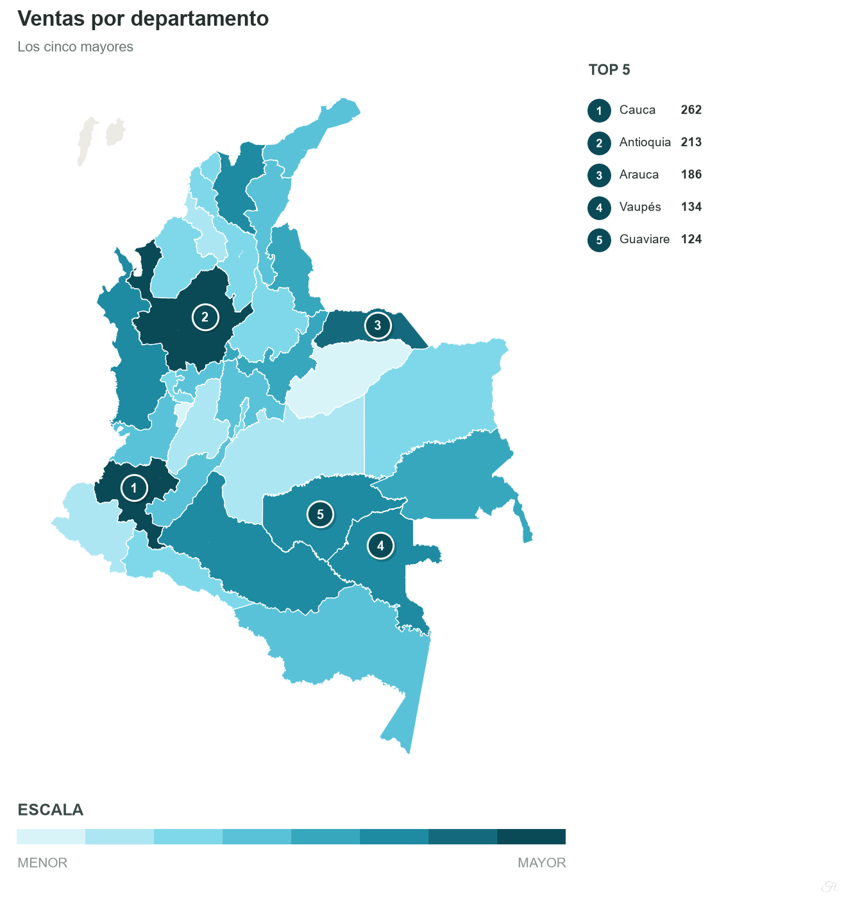
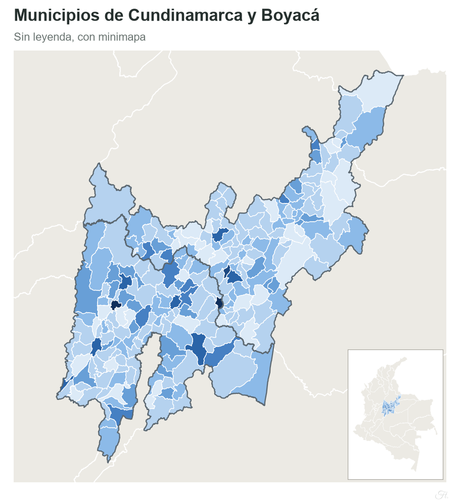
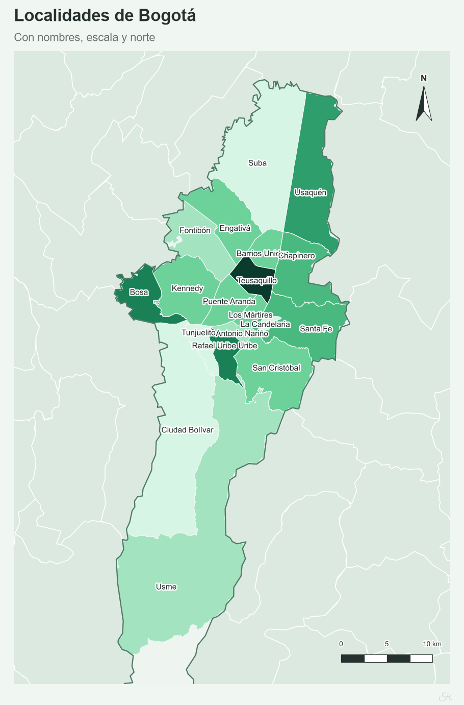
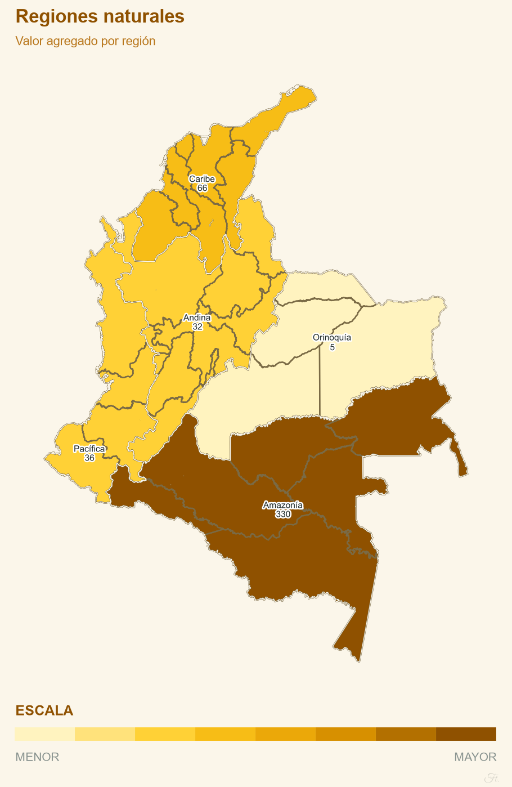
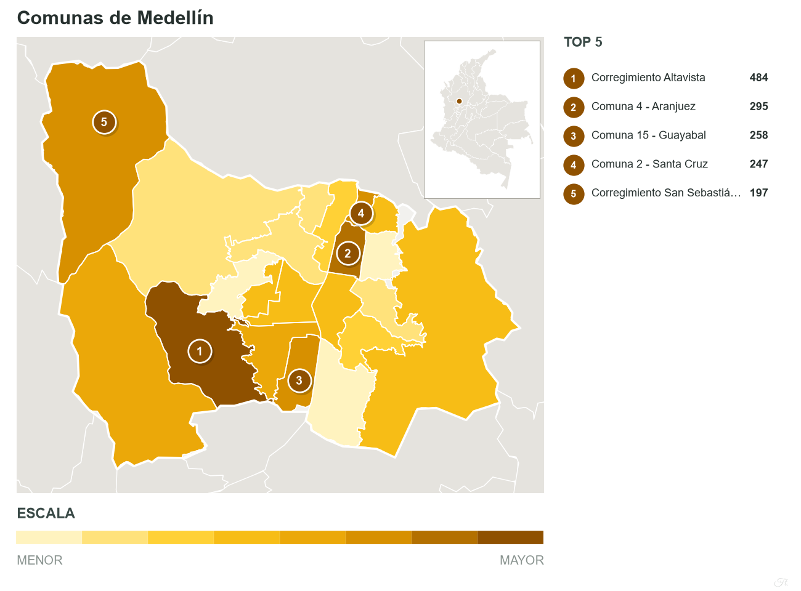
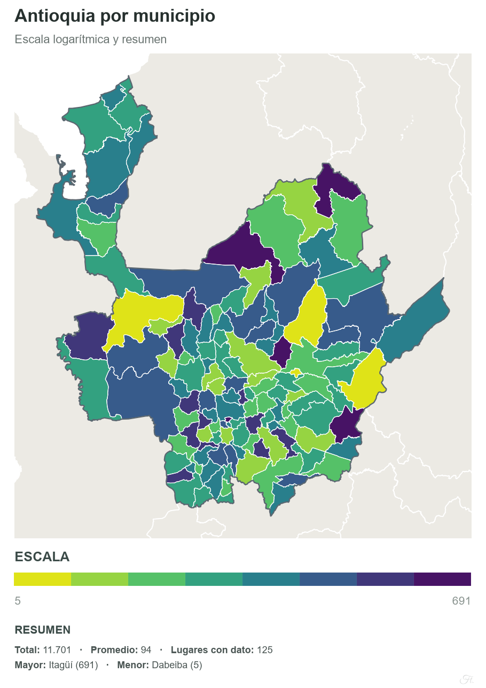

# Mapas de calor (Colombia heat maps)

**English** | [Español](README.es.md)

[](https://mapas-de-calor.streamlit.app/)
[](https://github.com/fabian-torresg/mapas-de-calor/actions/workflows/pruebas.yml)
[](https://www.python.org/)
[](LICENSE)
[](#for-developers)

A Python and Streamlit app that generates heat maps of Colombia by department, municipality, natural region, and
locality or commune for 22 cities. It takes data typed into the app or loaded from Excel or CSV, matches it to the
geography, and exports a map ready for reports and presentations.

**Live app:** <https://mapas-de-calor.streamlit.app/>

**Website:** <https://fabian-torresg.github.io/mapas-de-calor/>

## Features

- **Area:** country, regions, departments, municipalities (1,123) and cities with internal divisions. Supports partial
  selection and tight framing.
- **Data:** editable table or XLSX, XLS and CSV upload. Names are normalized (accents, capitalization, aliases) and
  unrecognized ones get a suggestion. Handles Colombian and international number formats and aggregates duplicates.
- **Coloring:** continuous scale (linear, square root, logarithmic or quantiles) or categories, with 15 palettes or
  custom colors. An optional segment column lets you group, color and outline places.
- **Design:** layered lines, magnifier for small places, minimap, scale bar, north arrow, labels, legend, statistical
  summary and ten templates.
- **Export:** map as PNG, JPG, TIFF, SVG or PDF; data as CSV, Excel, JSON, Parquet or GeoJSON. Saved maps download as
  a ZIP.
- **Language and theme:** Spanish and English; light and dark mode.

## Examples

Maps generated with the app from fictitious data (`examples/datos_ejemplo.xlsx`).

| | | |
| --- | --- | --- |
|  |  |  |
| Departments, with ranking | Municipalities, with minimap and no legend | Localities of Bogotá, with names |
|  |  |  |
| Natural regions, with name and value | Communes of Medellín, with magnifier | Antioquia, with statistical summary |

## Data format

Columns are recognized by their header, which is in Spanish. `Municipio` is only required for municipality maps and
`Segmento` is optional.

| Departamento | Municipio | Valor | Segmento |
| --- | --- | --- | --- |
| Antioquia | Rionegro | 1.250 | Oriente |
| Santander | Barichara | 38,5 | Turismo |
| Nariño | Pasto | 45 % | Sur |
| Meta | Villavicencio | $ 2.400.000 | Llanos |

The file [`examples/datos_ejemplo.xlsx`](examples/datos_ejemplo.xlsx) contains fictitious test data.

## Run it on your machine

You do not need to install anything to use the tool: it is available online. These steps are for running it locally or
modifying it. Requires Python 3.12 or later.

```bash
git clone https://github.com/fabian-torresg/mapas-de-calor.git
cd mapas-de-calor
pip install -r requirements.txt
streamlit run app.py
```

On the first run, the GADM municipal boundaries are downloaded (about 1 MB).

## For developers

### Use as a library

```python
import pandas as pd
import mapacalor as mc

df = pd.read_excel("examples/datos_ejemplo.xlsx", sheet_name="Municipios")
em = mc.emparejar(df, "Departamento", "Valor", col_muni="Municipio", nivel="municipio")
fig, info = mc.dibujar(em.tabla, mc.Estilo(nivel="municipio", deptos=["Cundinamarca", "Boyacá"], titulo="My map"))
fig.savefig("my_map.png")
```

### Structure

```text
app.py          Page flow and sidebar
ui/             Controls, styles, texts and tabs of the interface
mapacalor/      Engine: geometries, data reading and matching, drawing and palettes
data/           Municipality catalog, own geometries and signature typeface
docs/           Website (GitHub Pages)
examples/       Sample data
tests/          pytest tests
```

Stack: Python, pandas, GeoPandas, Shapely, matplotlib and Streamlit.

### Tests and deployment

```bash
pip install pytest
python -m pytest tests
```

GitHub Actions runs pyflakes, the tests on Python 3.12, 3.13 and 3.14, and a security scan. The app is deployed on
Streamlit Community Cloud pointing at `app.py`; `requirements.txt` defines the dependencies and `packages.txt` the
substitute fonts on Linux.

## Sources and licenses

- **Municipalities and departments:** [GADM 4.1](https://gadm.org), academic and non-commercial use. Not
  redistributed: the app downloads it from the official site.
- **Neighboring countries:** [Natural Earth](https://www.naturalearthdata.com), public domain.
- **Localities, communes and five municipalities created after GADM:** © contributors to
  [OpenStreetMap](https://www.openstreetmap.org/copyright), ODbL license.
- **Great Vibes typeface:** SIL Open Font License 1.1 (`data/fonts/OFL.txt`).
- **Code:** MIT license.

Claude Code (Anthropic) was used as a programming assistant.

## Author

**Fabián Torres** · [LinkedIn](https://www.linkedin.com/in/fabian-torresg) · [GitHub](https://github.com/fabian-torresg)
